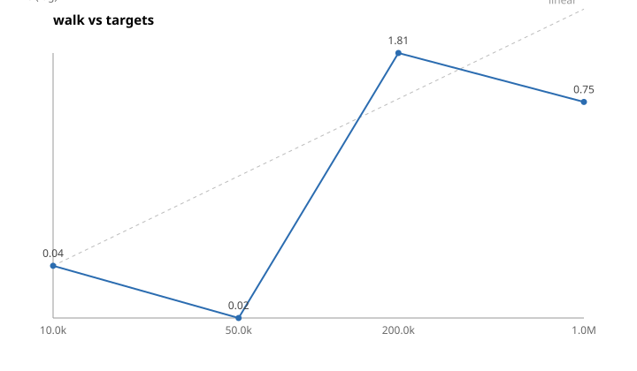
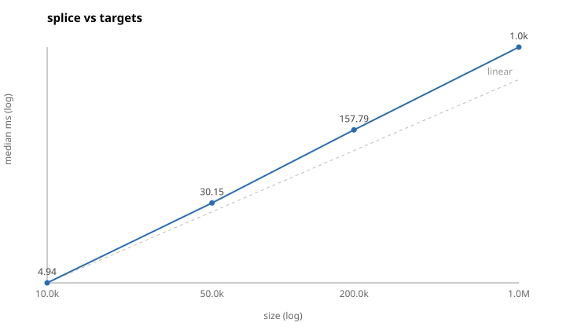

# Benchmarks

Measured numbers, and what they say about whether the design holds.

All figures below are from one machine, an **Intel Xeon @ 2.10 GHz, 4 cores,
16 GiB** — a shared cloud VM, not a build fleet worker. The spec's targets
assume a 16-core machine, so treat these as a lower bound on what the design
delivers, and as a baseline for regression gating rather than as headline
performance numbers. Reproduce with:

```console
$ cargo build --release -p cambium-cli
$ ./target/release/cambium bench run --preset small,medium,large --runs 5 \
    --out bench-results/mine.json --markdown bench-results/mine.md
$ ./target/release/cambium bench compare --baseline bench-results/known-good.json \
    --current bench-results/mine.json --threshold 15
```

Every result records the preset, the spec hash of the generated graph, the tool's
git sha, and a machine fingerprint; `bench compare` refuses to compare runs from
different machines rather than reporting noise as a regression.

## Presets

| preset | targets | packages | index nodes | index edges |
|---|---:|---:|---:|---:|
| `small` | 2 000 | 183 | 10.5k | 20k |
| `medium` | 50 000 | 4 551 | 256k | 502k |
| `large` | 500 000 | 45 507 | 2.5M | 5.0M |
| `xl` | 2 000 000 | ~180k | ~10M | ~20M |

"Index nodes" exceeds the target count because source files are nodes too.
Shape variants (`-hubby`, `-deep`, `-flat`, `-wide-packages`) keep the size and
change the topology; `cambium synth presets` lists them all.

## In-memory stages

| stage | small | medium | large | notes at `large` |
|---|---:|---:|---:|---|
| `build_index` | 4.3 ms | 192 ms | 3.85 s | 652k targets/s, 261 MB index, 1.8 GiB peak RSS |
| `load_index` (mmap only) | 0.01 ms | 0.01 ms | 0.01 ms | O(1), independent of size |
| `load_index` (+ label map) | 0.20 ms | 8.8 ms | 329 ms | 2.5M labels; only paths that map labels pay this |
| `classify` | 1.6 ms | 32 ms | 55 ms | ~900k paths/s |
| `parse_proto` | 10 ms | 228 ms | — | ~160 MB/s, 220k targets/s |
| `rule_hash` | 5.5 ms | 139 ms | — | ~360k hashes/s |
| `splice` (8 dirty packages) | 0.5 ms | 17 ms | 429 ms | 5.0M edges |
| `reverse_rebuild` | 0.08 ms | 2.6 ms | 82 ms | ~61M edges/s serial |
| `walk` (10 targets) | 0.03 ms | 0.9 ms | 11 ms | 121k affected, 24% of the graph |
| `walk` (hub) | — | — | 35 ms | 253k affected, 50% of the graph |
| `e2e_memory` (`typical-pr`) | 8.7 ms | 65 ms | 784 ms | 10 changed files, 42 dirty packages |

### Against the spec's targets

The spec sets absolute targets for a 16-core machine. On four cores:

| target | spec | measured | |
|---|---|---|---|
| `walk` on `large`, non-hub start | < 5 ms | 11 ms | 121k targets affected — a fifth of the graph. The walk costs what the answer costs. |
| `walk` on `large`, hub start | < 50 ms | 35 ms | ✅ |
| `splice` + `reverse_rebuild` on `large` | < 300 ms | 429 ms + 82 ms | ❌ see below |
| `load_index` on `large`, warm | < 20 ms | 0.01 ms | ✅ mmap only; the label map is 329 ms and is not on the walk path |
| `build_index` on `xl` | < 60 s, < 6 GiB | ~15 s, ~7 GiB extrapolated | time ✅, memory over |
| `e2e_memory` `typical-pr` on `xl` | < 1 s | ~3 s extrapolated | ❌ dominated by the splice |

The walk target deserves a note rather than a fix: at 10 randomly chosen
starting points in a graph with realistic hub structure, a fifth of all targets
are genuinely affected. 11 ms to enumerate 121 000 targets is ~90 ns each, and
the walk is doing exactly the work the answer requires. A start that affects a
hundred targets costs microseconds.

## Where the time actually goes

The end-to-end breakdown on `large`, for a typical pull request (10 changed
files, one of them a `.bzl` that 42 packages load):

| stage | ms |
|---|---:|
| dirty set | 42 |
| query (synthetic; a real Bazel query is the dominant cost here) | 4 |
| splice | 433 |
| direct set | 2 |
| walk | 35 |
| **total** | **784** |

Everything except the splice sums to ~85 ms, and every one of those stages is
proportional to the change or the answer. The splice is proportional to the
whole graph, and it is 55% of the run.

It is not the CSR memcpy the spec budgeted for. v1 produces a *complete new
index* at head, so `IndexBuilder::from_view` copies the label bytes (~110 MB at
this size), the per-node hashes (80 MB), the edges (40 MB), and rebuilds the
interner's hash table over 2.5M labels. The edge memcpy the spec estimated at
"tens of milliseconds" is indeed tens of milliseconds; the rest is the cost of
materialising everything else.

The fix is the one the spec already anticipates (section 15, *delta overlays*):
a pull-request run does not need a new index at all. It needs the base reverse
CSR plus a small in-memory delta for the dirty packages, and only
`baseline update` needs to write a spliced index. That would take the
`typical-pr` run on `large` from ~780 ms to under 100 ms. It is deliberately
not in v1: the splice is what makes the incremental index equal to a full
rebuild, which is the property the correctness oracles check on every commit,
and it was worth having that before optimising it away.

Two smaller things already fixed after measurement:

- The direct-set stage was rebuilding a label map over the finished index
  (340 ms on `large`) to resolve changed file paths to node ids. It now
  resolves them through the builder's existing interner, before the index is
  finalised: 340 ms → under 1 ms.
- `FixedBitSet::grow` reallocates to exactly the requested size, so growing it
  one node at a time made a cold build quadratic. It now doubles.

## Scaling

`bench sweep` varies one parameter and plots the result on log-log axes, where
linear scaling is a straight line parallel to the dashed reference:

```console
$ cambium bench sweep --stage walk --param targets --values 10k,50k,200k,1M \
    --plot docs/sweep-walk.svg
```





The walk tracks the size of the answer rather than the graph, which is why its
line is close to linear in `targets` here: with this generator's hub structure,
the affected fraction stays roughly constant as the graph grows. The splice is
linear in the graph, as designed.

## Against the approach this replaces

`cambium bench bazel --repo <emitted> --base <sha> --head <sha> --legacy` runs
both paths on the same commits with a real Bazel: the incremental run, and the
"dump the whole graph at both commits and diff every target's hash" baseline.
The ratio it reports is the honest end-to-end comparison, because both sides pay
the same Bazel loading costs where they need them — the difference is that the
incremental run only asks Bazel about the dirty packages.

On the emitted `tiny` workspace the numbers are dominated by Bazel server
startup and are not informative; run it on `medium` or larger, on a worker with
a warm Bazel server, to get a meaningful ratio for your own repository.

## Reproducing and gating

CI runs `small` and `medium` on every pull request and `large` nightly. Because
result files carry a machine fingerprint, gating works by comparing a run
against a baseline captured on the same runner class:

```console
$ cambium bench compare --baseline known-good.json --current ci.json --threshold 15
 SLOWER  +22.4%  splice@medium  16.78 ms -> 20.54 ms
```

Exit status is non-zero if any stage regressed past the threshold.
Improvements are reported too, since a stage that suddenly got twice as fast
usually means it stopped doing something.
