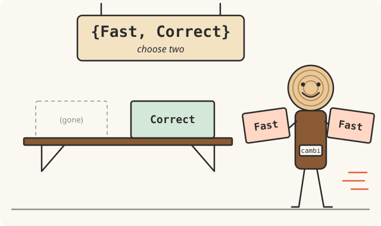

# cambium

cambium is a Bazel changed-targets and graph analysis tool, similar to
bazel-diff, Tango and target-determinator. Its goal is to go from a set of
file changes to the targets they affected in time proportional to the size
of the change, not the size of the build graph.

## Trying it

The command is `cambi`. The first thing to run on your repository is
`cambi profile`, which replays your recent history and tells you what
cambium would cost and save there. It needs no config and leaves your
checkout alone:

```console
$ cambi profile --commits 20
repository  abseil-cpp  at 022aad06b9, last 20 first-parent commits
targets     575         255 tests, 26 packages, 1 external repository
full index  21.1 s      at 2c256e7395 (572 targets, 254 tests); 86.9 KiB on disk (zstd-3), loads in 1 ms
per commit  556 ms      mean of 20 incremental, p50 64 ms, p90 2.5 s, max 2.6 s; 556 ms mean over all 20 with rebuilds
affected    302         targets on a typical commit (p50), 53% of 575 (manual included); mean 318, p90 524
tests       248         tests on a typical commit (p50), 97% of 255; mean 224, p90 253
global      0/20        no commit invalidated the whole graph
rebuilds    0/20        the whole graph was never rebuilt

    commit                                time affected  tests index
    f573cfb 09-21 12:23 Mark ABSL_D…     63 ms      524    253 = unchanged
    ef643ec 09-22 10:47 Speed up sh…     2.5 s        1      1 ~     1 rewritten
    7f008af 09-22 20:49 Split btree…     2.5 s        2      2 ~     2 rewritten
    d2d44c6 09-23 14:04 Update Tran…     64 ms      344    250 = unchanged
    583556e 09-26 02:07 PR #2172: T…     2.5 s      455    252 ~     3 rewritten
    …
```

That's abseil-cpp. Most commits only touch source files, so they're
answered from the index in about 60 ms. The few that change the graph itself (a
`BUILD` file, an added or deleted file) re-query just the packages they
touched, which takes a couple of seconds.

After that, ask what a branch affects, and why:

```console
$ cambi affected origin/main..HEAD --tests-only --format labels
//app:main_test
//lib/core:core_test
$ cambi explain //app:main_test origin/main..HEAD
```

`explain` prints the shortest path from that target back to the change.
[docs/CI.md](docs/CI.md) covers running it in a pipeline.

## Performance on large monorepos

I ran it on five open-source Bazel repositories, walking about 300 commits
of each one's history (74 for apollo) with one index carried forward a
commit at a time, the way a CI job would.

Here's how quickly it answers, as the median time per commit:

| repository | targets | cambium | bazel-diff | Tango |
|---|--:|--:|--:|--:|
| bazel | 24,805 | 96 ms | 7.0 s | 19.1 s |
| envoy | 34,097 | 3.1 s | 9.1 s | 106 s |
| sourcegraph | 70,450 | 459 ms | 12.8 s | 57.2 s |
| apollo | 25,973 | 274 ms | 13.4 s | 27.3 s |
| xla | 35,050 | 146 ms | 24.8 s | 218 s |

And here's how precise it is. Every answer was checked against Bazel's own
`rdeps` query: cambium never missed a target Bazel named. The table is the
median of Bazel's count over the tool's count, where 1.0 is exact and lower
means extra targets reported:

| repository | cambium | bazel-diff | Tango |
|---|--:|--:|--:|
| bazel | 1.000 | 1.000 | 1.000 |
| envoy | 0.986 | 1.002 | 0.899 |
| sourcegraph | 1.000 | 1.000 | 1.000 |
| apollo | 0.969 | 1.000 | 0.784 |
| xla | 1.000 | 1.000 | 1.000 |

Caveats: this is one 16-core Linux machine with Bazel's server kept warm,
so a fresh CI runner pays more (fetching the index, starting Bazel). The
peers ran once per commit on a sample of 40 commits from the same range.
target-determinator isn't benchmarked yet. The slowest 10% of cambium's
steps went up to 17 s. [docs/RESULTS.md](docs/RESULTS.md) has every number
and where each one falls short.

## Installing

There's no release yet, so you'll build from source. You'll need Rust
1.98+, a C compiler, `git`, and `bazel` or `bazelisk`. Linux and macOS only.

```console
$ git clone https://github.com/itsrainy/cambium && cd cambium
$ cargo install --path crates/cli --locked
```

Then, in your Bazel repository:

```console
$ cambi init --store-dir .cambium-store     # writes cambium.toml
$ cambi doctor                              # checks Bazel, config and store
```

[docs/INSTALL.md](docs/INSTALL.md) has the details.

## Design philosophy



That's the joke. The actual rule is the opposite: **it should never miss an
affected target.** Reporting a few extra targets is fine (and measured);
leaving one out is a bug. When cambium can't be sure, it says "everything"
(`//...`) rather than guessing.

Speed comes from not looking at what didn't change. A target's dependencies
are determined entirely by its `BUILD` file, the `.bzl` files it loads,
which files exist in its package, and a handful of repository-wide inputs
(`MODULE.bazel`, lockfiles, `.bazelrc`). Starlark can't read the clock or
the network during loading, so if none of those inputs changed, the
package's part of the graph didn't either. So a run goes:

1. Load the index from the most recent commit that has one.
2. Turn `git diff` into the set of packages whose inputs moved, using
   Bazel's own loading graph (Skyframe), saved alongside the index.
3. Re-query just those packages with real Bazel and splice the results in.
4. Walk reverse dependencies from everything that changed.

Some changes can't be answered incrementally, like a toolchain or platform
definition moving. Those fall back to re-indexing the whole repository
(still exact, just slower) or answer `//...`.
[docs/DESIGN.md](docs/DESIGN.md) goes through every case, including the
known gaps.

## More docs

- [docs/CLI.md](docs/CLI.md): every command, flag and config key
- [docs/CI.md](docs/CI.md): running it in a pipeline
- [docs/STORE.md](docs/STORE.md): where indexes live (a directory, S3, GCS, HTTP)
- [docs/DESIGN.md](docs/DESIGN.md): how it works, in detail, and where it doesn't yet
- [docs/CONTRACT.md](docs/CONTRACT.md): the JSON output and exit codes, for scripts
- [docs/DIAGNOSTICS.md](docs/DIAGNOSTICS.md): what each `CAMBI-` warning means
- [docs/INSTALL.md](docs/INSTALL.md): install details and requirements
- [docs/DEVELOPING.md](docs/DEVELOPING.md): working on cambium itself

## License

MIT, see [LICENSE](LICENSE). The vendored
`crates/cambium-proto/proto/build.proto` comes from Bazel and keeps its
Apache-2.0 license.
