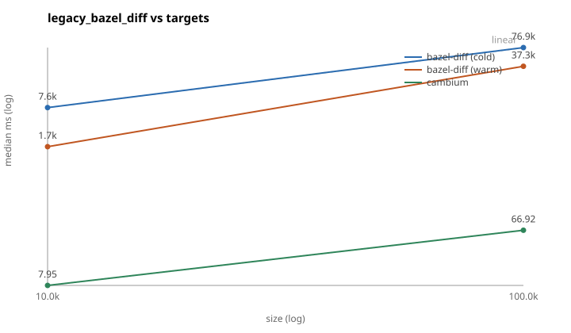

# The real-repository corpus

`cambi bench legacy` (see [BENCH.md](BENCH.md)) puts cambium and bazel-diff on
the *same synthetic graph*, so it can measure a headline number cheaply and on
every pull request. It cannot, on its own, prove anything about a real
repository's Starlark: real `select()` nesting, real macro-generated targets,
real external repositories, and a real commit history are exactly the things a
generator cannot be trusted to have gotten right by construction. The corpus
suite (`cambi corpus ...`, `crates/corpus`, `crates/compare`) is what closes
that gap — it runs cambium, unmodified, against a shortlist of real
Bazel monorepos and checks its answer against two independent tools and a
from-scratch `bazel query` oracle.

## What the suite proves

- **Soundness on real repositories.** `cambi index verify --against-bazel`
  already checks this on demand (see the root [README](../README.md#testing));
  the corpus suite runs the same class of check continuously, on repositories
  and commit histories cambium was never tuned against, and records recall
  as a hard pass/fail rather than a percentage to eyeball.
- **Like-for-like agreement (or documented disagreement) with the tools this
  replaces.** Precision against bazel-diff and Tango is informational — some
  disagreement is legitimate over-approximation — but recall against the
  `rdeps` oracle must be exactly 1.0, and any disagreement must fall into one
  of the eleven named classes below, or the run fails.
- **Updater throughput on a real history**, not just a synthetic one: replaying
  the last N first-parent commits gives p50/p90/p99 update latency and the
  dirty-set-size distribution `cambi bench` cannot, because no generator
  reproduces a real repo's commit shape.
- **Reproducibility.** Every stage is resumable
  (`corpus-results/<id>/state.json`) and pinned (`corpus.toml` records exact
  commits), so a report in this file can be regenerated byte-for-byte from the
  same inputs, and CI can schedule the expensive repos without redoing work a
  previous run already finished.

## The three producers

| producer | what it is | version pinned here |
|---|---|---|
| **cambium** | this repository, unmodified | whatever `cambi` was built from |
| **bazel-diff** | the tool cambium replaces; Rust port | Tinder/bazel-diff, tag `v46.1.0`, commit `27ce213b` (see [tools/bazel-diff/fetch.sh](../tools/bazel-diff/fetch.sh)) |
| **Tango** | Uber's changed-target service, driven locally | uber/tango, tag `v0.0.46`, commit `005b0dec` (see [tools/tango/README.md](../tools/tango/README.md)) |

Both bazel-diff and Tango are built from source at the pinned commit by their
`tools/*/fetch.sh` scripts, which cache their binaries under
`~/.cache/cambium/{bazel-diff,tango}` (override with `$CAMBIUM_BAZEL_DIFF_DIR`
/ `$CAMBIUM_TANGO_DIR`). `cambi corpus compare` runs whichever of the two are
installed and says so when one is missing rather than refusing to compare the
other (`crates/cli/src/cmd/corpus.rs::open_producer`).

## Running it locally

```console
$ tools/bazel-diff/fetch.sh                 # builds bazel-diff-rust, once
$ tools/tango/fetch.sh                      # builds tango-cli, once
$ cambi corpus all bazel --bazel-binary ~/.cache/cambium/bin/bazelisk
```

`corpus all` runs `fetch`, `build`, `replay`, `pairs`, `compare`, then `report`
in one call; each is also its own subcommand (`cambi corpus fetch|build|
replay|pairs|compare|report <id>`) for rerunning one stage. State lives in
`corpus-results/<id>/state.json`, so a rerun resumes rather than redoing an
hour of `bazel query`.

```console
$ cambi corpus compare bazel --kind adjacent --kind pr --kind stress \
    --oracle-sample 100 --bazel-version 8.x --cap 40
```

`--bazel-version` (`7.x`, `8.x`, `9.x`, ...) drives bazelisk via
`USE_BAZEL_VERSION` and suffixes every result file, so the version matrix in
`corpus.toml`'s `bazel_versions` produces separate `replay-*` and `compare-*`
JSON per version rather than overwriting one another — which is the point:
`bazel` and `envoy` are the two repositories checked against more than one
Bazel major version, precisely because that is where cambium's Bazel-version
assumptions are most likely to break first.

Corpus and cache locations default to `~/.cache/cambium/corpus`
(`$CAMBIUM_CORPUS_DIR`): a bare mirror per repo, a worktree, a dir-store, and a
**shared** `repository_cache` / `disk_cache` so the version matrix does not
redownload every external dependency per Bazel version.

## Machine requirements

The corpus repositories are real, large Bazel monorepos with real external
dependencies. Budget, per concurrent repo:

- **16+ cores** — Bazel's own build/query parallelism dominates wall time.
- **64+ GB RAM** — `envoy` and `xla` load large query results into a single
  `bazel` server process.
- **500+ GB disk** — checkouts, Bazel's repository cache, and disk cache for
  several repos and Bazel versions at once; `xla` and `tensorflow` alone can
  need low hundreds of GB of external fetches.

A laptop-class machine can run `bazel` (the repo) end to end; it is the
smallest and cleanest entry in the corpus specifically so that a from-scratch
contributor can exercise the whole pipeline without provisioning the above.

## Disagreement classes

Every disagreement between cambium and a producer, or between cambium and the
`rdeps` oracle, is put into exactly one of these classes
(`crates/compare/src/classify.rs`). `cambium_missing` and `unclassified` are
the only two that fail a comparison; the rest are recorded for the report but
do not. `cambi corpus report` regenerates this same table, with live counts,
into each repository's section.

| class | meaning | action |
|---|---|---|
| `cambium_extra_select` | cambium reports a label because it keeps `select()` branches a *configured* Bazel query resolves away | none — documented over-approximation (see [BENCH.md](BENCH.md#legacy_bazel_diff-like-for-like-against-bazel-diff)) |
| `cambium_extra_implicit` | cambium reports a label reachable only through an implicit dependency (e.g. a toolchain) the other producer does not walk | none — over-approximation |
| `cambium_extra_visibility` | the two producers' canonical rules differ only in `visibility`/`tags`, which cambium's hash intentionally ignores | none — over-approximation |
| `cambium_extra_bzl` | the target's own rule proto is byte-identical at both revisions, but a `.bzl` its package loads changed, so cambium marked the whole loading package direct | none — over-approximation; on a real repository this is the largest cambium-side class |
| `cambium_extra_deleted` | a dependency of the target was deleted between base and head | none — not an approximation: a target whose dep vanished really may build differently |
| `cambium_extra_build_glob` | reached from a changed `BUILD` file that a `glob()`bing filegroup consumes as a *source* | none — the file's content genuinely is an input to that filegroup |
| `bazeldiff_extra_content` | bazel-diff reports a changed path with no consumer in cambium's head index (e.g. a file outside any package, or a hash-only artifact) | none — bazel-diff hashes source content cambium's graph does not name |
| `bazeldiff_extra_external` | the disagreement is confined to `@external//...` labels, which the tools may canonicalise differently (`@ext//:x` vs `@@ext~//:x`) | none — canonicalisation only, not a graph difference |
| `bazeldiff_extra_external_content` | a `//...` label whose own rule (modulo `visibility`/`tags`), source inputs and transitive `//...` dependencies are all unchanged, and which depends on something external. bazel-diff's digests include the external graph, and on `bazel/bazel` under `--keep_going` how much of that graph loads varies between invocations | none — external load nondeterminism in the producer, not a graph difference. All four conditions must hold; drop any one and the label stays `cambium_missing` |
| `cambium_missing` | a label the oracle or a producer says is impacted, that cambium's `affected` does not report | **fail** — this is unsoundness |
| `unclassified` | a disagreement none of the above rules explain | **fail** — needs a new class or a real bug fix before it can be waved through |

## Pass criteria

A `cambi corpus compare` run passes when, for every pair compared:

- recall against the `rdeps` oracle is exactly 1.0 (cambium's walk is a
  superset of the oracle's sampled roots);
- zero `cambium_missing` disagreements against every producer;
- zero `unclassified` disagreements.

Precision against bazel-diff and Tango (`|producer ∩ cambium| / |cambium|`) is
reported per producer but is informational, not gating — see the disagreement
table above for why cambium is expected to report more than either tool
sometimes.

## Results

The tables below are regenerated by `cambi corpus report <id>`
(`crates/compare/src/report.rs`), which rewrites the region between each pair
of HTML comment markers in place; nothing outside a marked region is touched
by that command, so hand-written prose — including **Findings** — survives a
rerun. Four regions are not a repository: `top`, `matrix` and `bench` are
rendered from *every* repository's results at once (so a per-repo nightly job
does not drop its neighbours' rows), and each `<id>` region is that
repository's own section.

Anything a run could not measure reads `n/a` rather than being omitted: a
repository with a replay and no comparison still gets its cold-build and
latency tables, and a result file written before a field existed says so.

<!-- corpus:top:begin -->
| repo | pin | Bazel | targets | cold build | replay p50/p90 | globals | pairs | pass/fail | min recall | precision | producer cold p50 vs cambium warm p50 |
|---|---|---|---:|---:|---:|---|---:|---:|---:|---|---|
| [bazel](#bazel) | `948b8c70e281` | n/a | 24,519 | 20 s | 2 ms / 324 ms | **16**<br>8× `MODULE.bazel` matches an invalidator<br>2× `src/main/starlark/builtins_bzl/common/buil…<br>1× `.bazelrc` matches an invalidator | 2 | 2 / 0 | 100.0% | bazel-diff-rust 100.0%<br>tango 100.0% | bazel-diff-rust 29.0 s vs 196 ms (148×)<br>tango 72.9 s vs 196 ms (372×) |
| [envoy](#envoy) | `7ba51266cc60` | n/a | 28,449 | 78 s | 4 ms / 1648 ms | **8**<br>3× `api/bazel/deps.yaml` matches an invalidator<br>2× `api/bazel/api_build_system.bzl` matches an…<br>1× `api/bazel/repositories.bzl` matches an inv… | 0 | 0 / 0 | n/a | n/a | n/a |
| [bazel-8](#bazel-8) | `8584d8648760` | n/a | 19,552 | 46 s | 2 ms / 306 ms | **6**<br>2× `src/main/starlark/builtins_bzl/common/buil…<br>2× rbuildfiles finished with errors under --ke…<br>1× `MODULE.bazel` matches an invalidator | 0 | 0 / 0 | n/a | n/a | n/a |

Replay p50/p90 are over **non-global** commits (the ones an updater actually walks); the per-repo sections give both distributions. `pass/fail` counts compared pairs. Precision against a producer is informational; recall against the `rdeps` oracle is the gate.
<!-- corpus:top:end -->
### Version matrix

Does cambium load, and agree, under each Bazel major? The `mirror` field in
[corpus.toml](../corpus.toml) groups `bazel`/`bazel-8`/`bazel-7` and
`envoy`/`envoy-7` into one row each, since they are the same repository at
pins whose own `.bazelversion` is the major under test.

<!-- corpus:matrix:begin -->
| repository | unrecorded | Bazel 8.x |
|---|---|---|
| **bazel** | `bazel`<br>loads: 24,519 targets<br>agrees: 2/2 pairs, recall 100.0% | `bazel-8`<br>loads: 19,552 targets<br>agrees: not compared |
| **envoy** | `envoy`<br>loads: 28,449 targets<br>agrees: not compared | not run |

Each cell is the manifest entry that covers that major, whether its index loaded, and whether the producers agreed. "loads" is a cold `bazel query //...` that built an index; "agrees" is pairs passed out of pairs compared, with the worst oracle recall seen.
<!-- corpus:matrix:end -->
## Synthetic scaling

<!-- corpus:bench:begin -->
These are *synthetic* graphs (`cambi bench sweep --stage legacy_bazel_diff`), not the corpus above: cambium and bazel-diff on the same generated workspace, the same change, and a `bazel` shim that replays a recorded query, so what is measured is each tool's own work rather than a Bazel server. See [BENCH.md](BENCH.md#legacy_bazel_diff-like-for-like-against-bazel-diff).

| targets | bazel-diff cold | bazel-diff warm | cambium | cambium p90 | vs cold | vs warm | agreed labels |
|---:|---:|---:|---:|---:|---:|---:|---|
| 10,039 | 7593 ms | 1678 ms | 8 ms | 8 ms | 949× | 210× | 7,526 — none missed |
| 100,377 | 76.9 s | 37.3 s | 67 ms | 127 ms | 1147× | 557× | 66,298 — none missed |

cambium's column is its warm, in-memory update against the base index — the operation bazel-diff's warm column is also doing. `agreed` is the label sets matching up to `select()`; any label bazel-diff reports and cambium does not fails the stage outright, so a row exists only because that count was zero.


<!-- corpus:bench:end -->
## Findings

_Hand-written; `cambi corpus report` never touches this section._

TODO: what the runs above actually taught us.

## Per-repository results

### bazel

<!-- corpus:bazel:begin -->
- pin: `948b8c70e281`
- Bazel: n/a
- generated: 2026-09-06
- tool: `5ba03a4`

#### Cold build

| targets | edges | packages | index bytes | wall |
|---:|---:|---:|---:|---:|
| 24,519 | 53,242 | 524 | 3,754,856 | 19.5 s |

#### Replay (300 commits, `ac3a6d70e804..948b8c70e281`)

| over | commits | p50 | p90 | p99 | max |
|---|---:|---:|---:|---:|---:|
| all commits | 300 | 2 ms | 495 ms | 25.3 s | 41.0 s |
| non-global commits | 284 | 2 ms | 324 ms | 3307 ms | 25.3 s |

A *global* commit touches an invalidator, so cambium answers `//...` without walking: it is fast for the wrong reason, and including it would flatter the updater. Both rows are given so the difference is visible.

- zero-dirty commits (a diff that dirtied no package): **63.3%**
- largest dirty set: **377 packages** at `0859dab4a7b2`
- `rbuildfiles` calls: 1 of 300 commits
- mean affected targets: 851

Global commits: **16**

| reason | commits |
|---|---:|
| `MODULE.bazel` matches an invalidator | 8 |
| `src/main/starlark/builtins_bzl/common/builtin_exec_platforms.bzl` matches an invalidator | 2 |
| `.bazelrc` matches an invalidator | 1 |
| `BUILD` matches an invalidator | 1 |
| `src/main/starlark/builtins_bzl/common/java/java_common.bzl` matches an invalidator | 1 |
| `tools/build_defs/repo/git.bzl` matches an invalidator | 1 |
| `tools/build_defs/repo/utils.bzl` matches an invalidator | 1 |
| rbuildfiles finished with errors under --keep_going (bazel exit 3) | 1 |

Incremental-equals-full oracle at the pin: **pass**

#### Three-way comparison

2 pairs compared, 2 passed, 0 failed (1 of them global, which pass by construction). Worst oracle recall: **100.0%**.

| Bazel | producer | pairs | passed | precision | min recall |
|---|---|---:|---:|---:|---:|
| `n/a` | bazel-diff-rust | 2 | 2 | 100.0% | 100.0% |
| `n/a` | tango | 2 | 2 | 100.0% | 100.0% |

#### Timings (p50 / p90 over the compared pairs)

| Bazel | tool | cold | warm |
|---|---|---:|---:|
| `n/a` | bazel-diff-rust | 29.0 s / 29.0 s | 14.2 s / 14.2 s |
| `n/a` | tango | 72.9 s / 72.9 s | n/a |
| `n/a` | **cambium** | 293 ms / 293 ms | 196 ms / 196 ms |

cambium's *cold* is a full index build from `bazel query //...`; its *warm* is an update against the published baseline, which is what a CI job actually pays. bazel-diff's warm reuses the base revision's hashes; Tango has no warm mode, so its cell is `n/a`.

#### Disagreements by class

| class | labels | fails the run | meaning |
|---|---:|---|---|
| `cambium_extra_select` | 0 | no | cambium keeps `select()` branches a configured Bazel query resolves away |
| `cambium_extra_implicit` | 0 | no | reached only through an implicit (`$`-prefixed) attribute edge the producer does not walk |
| `cambium_extra_visibility` | 0 | no | the two rules differ only in `visibility`/`tags`, which cambium's hash ignores |
| `cambium_extra_bzl` | 0 | no | the target's own rule is byte-identical, but a `.bzl` its package loads changed |
| `cambium_extra_deleted` | 0 | no | a dependency of this target was deleted between base and head |
| `cambium_extra_build_glob` | 0 | no | reached from a changed `BUILD` file that a `glob()`bing filegroup consumes as a source |
| `bazeldiff_extra_content` | 0 | no | a changed path with no consumer in cambium's head index (content the graph does not name) |
| `bazeldiff_extra_external` | 0 | no | confined to `@external//...` labels, which cambium does not index and the tools canonicalise differently |
| `bazeldiff_extra_external_content` | 0 | no | an unchanged `//...` rule that depends on something external; how much of the external graph loads varies between the producer's runs |
| `cambium_missing` | 0 | **yes** | **fails**: the oracle or a producer reached something cambium did not — unsoundness |
| `unclassified` | 0 | **yes** | **fails**: no predicate explains the disagreement; needs a new class or a fix |

Counts are labels, summed over every pair and producer.

- `bazel-diff-rust`: no distances reported; 546 file-target rows dropped to match cambium's universe.
- `tango`: depth agrees on 27.3% of shared labels (1 pair); 545 file-target rows dropped to match cambium's universe.

#### `rdeps` oracle

| pairs with an oracle | roots sampled | roots skipped | partial pairs | partial batches | missing labels |
|---:|---:|---:|---:|---:|---:|
| 1 | 6 | 0 | 1 | 1 | 0 |

A *partial* batch is a `--keep_going` query that exited 3: Bazel answered for what loaded. The oracle is a lower bound on what cambium must contain, so a partial answer is still sound to check against — it just proves less. `missing labels` is the count that gates the run, and must be zero.
<!-- corpus:bazel:end -->
### envoy

<!-- corpus:envoy:begin -->
- pin: `7ba51266cc60`
- Bazel: n/a
- generated: 2026-09-06
- tool: `5ba03a4`

#### Cold build

| targets | edges | packages | index bytes | wall |
|---:|---:|---:|---:|---:|
| 28,449 | 389,619 | 1,211 | 6,740,392 | 78.1 s |

#### Replay (36 commits, `4cf50c646cf5..7ba51266cc60`)

_This replay has not finished; the numbers below cover the commits it has replayed so far._

| over | commits | p50 | p90 | p99 | max |
|---|---:|---:|---:|---:|---:|
| all commits | 36 | 949 ms | 68.6 s | 418.0 s | 418.0 s |
| non-global commits | 28 | 4 ms | 1648 ms | 3538 ms | 3538 ms |

A *global* commit touches an invalidator, so cambium answers `//...` without walking: it is fast for the wrong reason, and including it would flatter the updater. Both rows are given so the difference is visible.

- zero-dirty commits (a diff that dirtied no package): **50.0%**
- largest dirty set: **6 packages** at `75994f6552de`
- `rbuildfiles` calls: 1 of 36 commits
- mean affected targets: 911

Global commits: **8**

| reason | commits |
|---|---:|
| `api/bazel/deps.yaml` matches an invalidator | 3 |
| `api/bazel/api_build_system.bzl` matches an invalidator | 2 |
| `api/bazel/repositories.bzl` matches an invalidator | 1 |
| `bazel/repository_locations.bzl` matches an invalidator | 1 |
| rbuildfiles finished with errors under --keep_going (bazel exit 3) | 1 |

_No three-way comparison for this repository yet: no `compare-*.json`, so there are no precision, recall or disagreement numbers._
<!-- corpus:envoy:end -->
### bazel-8

<!-- corpus:bazel-8:begin -->
not yet run
<!-- corpus:bazel-8:end -->

### bazel-7

<!-- corpus:bazel-7:begin -->
not yet run
<!-- corpus:bazel-7:end -->

### envoy-7

<!-- corpus:envoy-7:begin -->
not yet run
<!-- corpus:envoy-7:end -->

### sourcegraph

<!-- corpus:sourcegraph:begin -->
not yet run
<!-- corpus:sourcegraph:end -->

### apollo

<!-- corpus:apollo:begin -->
not yet run
<!-- corpus:apollo:end -->

### xla

<!-- corpus:xla:begin -->
not yet run
<!-- corpus:xla:end -->

### tensorflow

Carries `skip = true` in [corpus.toml](../corpus.toml): the largest public
Bazel graph, run monthly or on demand rather than on the weekly schedule with
sourcegraph/apollo/xla. See `.github/workflows/corpus-weekly.yml` for the
monthly job (its `skip`-override invocation is a TODO there until `cambi
corpus` grows a flag to ignore the manifest's `skip`, or the flag is flipped
for a deliberate run).

<!-- corpus:tensorflow:begin -->
not yet run
<!-- corpus:tensorflow:end -->
