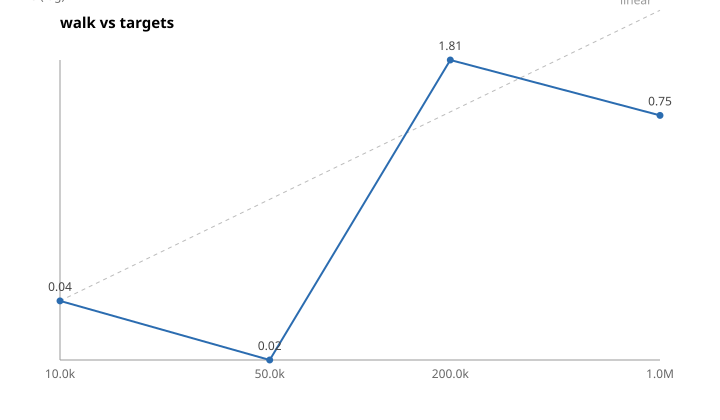
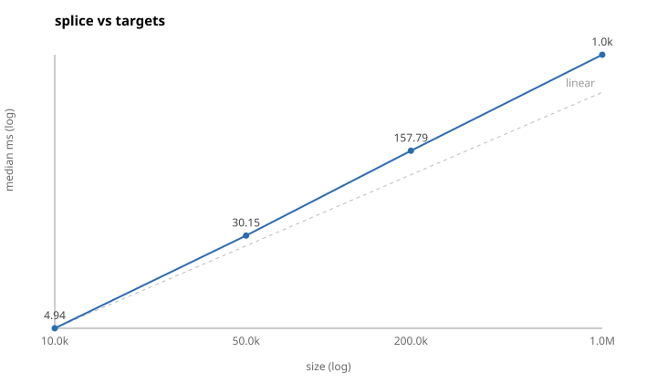
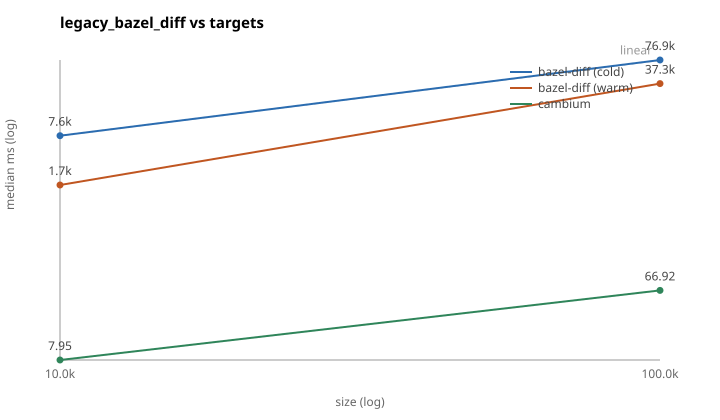

# Benchmark results

What `cambium-bench` measured, and on what. The words (subject, tool, oracle,
workload, run) are defined in [METHODOLOGY.md](METHODOLOGY.md), and nothing
here means anything without them.

Every table below is generated by `cambium-bench report`, which rewrites the
region between each pair of HTML comment markers and touches nothing outside
one. Hand-written prose survives a rerun; **Findings** is never touched. Two
regions are not a subject: `top` and `synthetic` render from every subject's
results at once, so a per-subject nightly job does not drop its neighbours'
rows.

Anything a run could not measure reads `n/a` rather than being omitted: a
subject with a history and no change-set run still gets its cold-build and
latency tables, and a result file written before a field existed says so.

For a first reading, [Summary](#summary) has one row per subject and a
legend for its columns, and the README's "How it did" says the same in two
paragraphs. **Findings**, next, is the maintainers' account of the runs,
with the commits and machines they ran on.

## Findings

_Hand-written. `cambium-bench report` never touches this section._

**The benchmark is what found the engine's bugs, and that is the strongest
thing it has done.** Eleven of them, each fixed with the run that exposed it in
the same change: `generator_location` in the rule hash, which bazel-diff and
Tango both drop; a modified `BUILD` file being a direct input of any rule that
globs it; deleting `BUILD` while `BUILD.bazel` remained not being a package
deletion; ignore globs silently dropping consumed files; `rbuildfiles` under
`--keep_going` exiting 3, where the only sound answers are "tombstone" or
"escalate"; a stale store lineage winning over a compatible one; a missing base
index being built with Bazel on the *head* checkout; `label_flag` /
`label_setting` edges whose `build_setting_default` Bazel types as `STRING`, so
the first fix matched `LABEL` and never fired; `--noimplicit_deps` dropping
real main-repo edges through a rule's private `attr.label(default=…)`; a `.bzl`
loaded only from `MODULE.bazel` or `WORKSPACE` being treated as dead; and tools
sharing cambium's `--output_base` across workspaces, which poisoned the
external tree. None of these was reachable from a generated graph: that is the
argument for real subjects, and the only one that matters.

**Externals are the boundary, and the `rdeps` oracle is what drew it.** A
dependency path that leaves `//...` and comes back is invisible to cambium: it
queries `//...`, so an external label is a leaf in the index (reachable, with
no outgoing edges), and the reverse walk stops there. envoy has two instances
at its pin; one of them, `@quiche` re-exporting `@envoy//source/…`, has no
cheap invalidator, so the change set keeps failing rather than being waved
through. xla was the larger case: `third_party/tsl`
is both a set of main-repo packages and the repository `@tsl`, whose BUILD
files name `@xla//xla/...` back at the main repository, so a change under
`//xla/tsl` had consumers the reverse walk could not reach. Four steps of the
300-step walk under-reported for that reason in box run A, 4, 4, 48 and 48
labels, every one of them confirmed an external route by the oracle's own
`somepath` probe (docs/XLA_MAIN_REPO_MISSES.md). Indexing the repositories
whose sources live in the tree (Phase 5 of docs/ROADMAP.md) is the answer,
and box run B measures it: the universe is widened by `@tsl` on xla and
`@envoy_api` on envoy, an external package's key is Bazel's own spelling
(`@tsl//tsl/platform`), and all four steps are sound, worst recall 1.0000
over 296 oracle steps. The rebuild oracle still fails at both pins, and
what its rows were is further down this section.

Where the changed side of the round trip is a nameable path an invalidator is
the sound fix, which is how `subject_repos.toml` came to list
`api/**` and `changelogs/**` for envoy. It no longer does: the external-repository
stage derives both from `MODULE.bazel` and the workspace `.bzl` closure and maps
them onto `@envoy_api` / `@envoy_repo`, so envoy's invalidator list is now empty
and the mapping is what the rebuild oracle checks.

**The runs these tables are from.** bazel, sourcegraph and apollo are box
run A, 2026-09-19 to 2026-09-20; xla is box run B, 2026-09-23, the engine at
`7a4abfd` with in-tree external repositories indexed; envoy is box run E,
2026-09-25, the engine at `a1606bf` with the consumer table and the oracle
rooted at in-tree labels. Only the subjects a change can reach were re-run.
Both runs: 300 first-parent steps each except apollo's 74, the recall oracle
on every step, the bazel-diff and tango peers on a stratified sample of 40,
every subject cold-building its own index at the start of its window (and
again at the pin for the rebuild oracle), no index store in play. Run A
was the first clean five-subject measurement with a fresh index throughout
and the first to run the whole loading layer.

**envoy's section below is box run E (2026-09-25): 288 oracle steps, 0
missing, worst recall 1.0.** Three runs got it there. Run B's envoy line
read recall 1.0 because its `rdeps` oracle rooted only main-repo labels, and
a `.proto` under `api/` has none (`//...` stops at the boundary); the engine
it measured also joined such a path to nothing at every base before envoy's
bzlmod migration, so a proto edit reached no consumer and nothing noticed.
Both were fixed (`74a124a`, `fa524b6`), and run C (2026-09-24, `a07bad7`)
then failed at 0.2142: four steps, 510, 164, 12 and 1 labels short, every
one reached by Bazel through `@grpc`. grpc's xDS client consumes
`@envoy_api` protos (101 rules at the pin, the only external repository
that does), and a test that links `@grpc//:grpc` depends on `fault.proto`
through `@grpc//src/core:grpc_xds_client`; cambium indexes `//...` and the
in-tree repositories, so `@grpc//:grpc` was a leaf with no outgoing edges
and the path back into `@envoy_api` invisible. The fix is a table the cold
build asks Bazel for, once per indexed repository: which external
repositories consume it and which of its packages (`b11c1b1`, format 13);
a change to a consumed package dirties the consumer and its leaves seed the
walk. Run D (2026-09-25, `ec2421a`) closed those four and missed one label
on one step, the same label run C had also missed there:
`//source/extensions/transport_sockets/alts:handshaker_cc_grpc`, whose only
route into `@envoy_api` is a `@grpc` proto. The table is built at the
walk's first commit, where the repository is named `com_github_grpc_grpc`;
step 32 renames it to `grpc`, every package re-queried after that spells
its deps `@grpc//...`, and the carried table kept naming a repository no
label spelled, so nothing was seeded. A run that overflows the dirty limit
re-queries `//...` on a server that has just loaded everything, and now
asks for the table again there (`a1606bf`). Run E is that engine. Its
answer is coarse where the route is: a change to a consumed `@envoy_api`
package seeds every `@grpc` leaf, so the step whose oracle is 649 labels
answers 5035, which is the tightness p50 of 0.973 against run C's 0.986.

**What the rebuild oracle's rows were.** Every walk in the table except
bazel's fails its rebuild oracle (the ⚠). On envoy (run E) and xla (run B)
the failure is loading-layer rows the reference build at the pin holds and
the walked index does not: 306 unexplained on envoy, beside 13449 counted
as `boundary_probe`, and 314 on xla. Read row by row, they are the
reference build's and not the lineage's. The reference build ran
`cambi index build` in the walk's own checkout on the walk's own output
base, so it dumped the Skyframe graph of the one Bazel server that every
step's queries had run on, and every `rdeps(//..., ...)` of the oracle too,
which fetches every external repository `//...` reaches; the lineage's base
had been cold-built on a fresh server (envoy at `b6e7e12`, xla at
`aa90816`, the heads of their last global steps). envoy ran
`--enable_workspace` until step 293 (steps in these paragraphs are indices
into the walk record, counted from 0), and Bazel probes for a `WORKSPACE`
file in a package directory only in that mode. 298 of the 306 are rows no
build at the pin writes (patches and `build_file` inputs of WORKSPACE-era
repository rules, most of them deleted inside the window and the oldest at
step 10; `WORKSPACE` probes; probes of package directories deleted in the
window), and the other 8 only a dependency traversal writes. The 13449 are
the same leftovers, every one a `WORKSPACE`, `WORKSPACE.bazel` or
`WORKSPACE.bzlmod` probe: the reference layer held 1737 `FILE` rows for a
`WORKSPACE` against the walked layer's 25. xla has never enabled WORKSPACE.
280 of its 314 are inputs of external repositories (244 rows for 61
`patch_file` patches under `third_party/**`, which the fetch watches; 32
for `build_file` files, which it does not watch and which were statted
through the external repository's `BUILD.bazel` symlink when its root
package loaded; 4 for a pip lock file the module extension reads), 30
are two main-repo packages (`tsl/platform`, `tsl/profiler/protobuf`) that
dead labels in xla's own Starlark name and only a dependency traversal
visits, and 4 are the root `WORKSPACE`, whose reader is not identified; the
fresh base at `aa90816` holds none of them. Walking the reverse rows up
from every one of them reaches no `PACKAGE`, `GLOB` or `BZL_LOAD` node
except those two dead packages, which have no targets. The reference build
now starts on a fresh Bazel server (docs/METHODOLOGY.md), and box run F
measured that: both pins pass with it (below). The ⚠ on envoy and xla stays
in the tables, which are still runs E and B, until a run's tables replace
them.
sourcegraph's (its graph) and apollo's (6690 rows), both from run A, ran
against the same kind of reference build and have not been read row by row.
The rows were issue #27. Reading them turned up two real under-reports they
did not cause, an `@llvm-raw` route on xla and two WORKSPACE-era patches on
envoy (docs/ROADMAP.md, Phase 5).

**What else runs C to E measured.** The oracle's own answer is
short on 123 of envoy's 288 steps by a class the harness names
(`oracle_unresolved`, `2868471`): `bazel query` evaluates every `select`
branch, envoy names `@perfetto//:perfetto` under `//bazel:enable_perf_tracing`
and the perfetto module's overlay `BUILD.bazel` shadows the `BUILD` that
defines it, so the target does not exist, and under `--keep_going` every
target that transitively depends on an unresolvable one leaves the `rdeps`
universe. `source/common/common` is under most of the tree. The same holds
for `@libbpf//:libbpf`, `@openssl//:ssl`, `@libpfm//` and two tools packages
that name repositories envoy's `MODULE.bazel` does not declare. `cquery`
would resolve the `select` and crashes Bazel with an internal error on one of
those unknown repositories, so the oracle stays a lower bound and the report
says by what. The rebuild oracle at the pin was vacuous in run B (its last
step was a cold rebuild, so the pin was compared with itself); run C's real
comparison found 13755 missing loading-layer rows, most of them `WORKSPACE`
and `WORKSPACE.bazel` probes in package directories where no such file
exists. `2868471` made those a class (`boundary_probe`, 13449 of run E's
13755) on the reading that a cold dump carries such probes and a refresh
dump does not; the paragraph above has what they were instead. The same
comparison names 11 rules whose hash differs from the cold rebuild, all
under `tools/` (`//tools/code:check`, `//tools/code_format:check_format`,
`//tools/coverage:report_generator_script` and eight more). Each fails the
rebuild oracle on its own, whatever the rows say; why the hashes differ is
not diagnosed, and whether they survive a fresh reference build is for the
next run to show.

**Box run F (2026-09-26) is not in the tables.** It walked envoy and xla,
300 steps each, with the engine at `986aa75` and two changes to the
harness: the `rdeps` oracle is also rooted at every external repository
whose recorded input changed (Bazel's marker files say which), and the
rebuild oracle's reference build starts on a fresh Bazel server. envoy
failed 3 of its 282 oracle steps, worst recall 0.7599, with the oracle
rooted at repositories on 21 of them. Step 161 (`bazel/c-ares.patch`)
missed 145 of 604 labels, every one reaching `@c-ares` only through
`@grpc//:grpc++`; a repository that moves now seeds every external leaf
whose deps closure runs through it (`0a0e894`, index format 16). Steps 191
and 194, in the WORKSPACE-era rename of `io_bazel_rules_go` to `rules_go`,
each missed `//tools/protojsonschema:protoc_gen_jsonschema_proto_plugin`,
whose only dep is a repository declared in
`@envoy_api//bazel:repositories.bzl`, a file the static read never enters;
a definer that runs code the index never read now also dirties every
repository the graph names and the consumer table does not (`151f888`).
xla failed 26 of its 296 oracle steps, worst recall 0.9272, all from one
tombstoning defect at two LLVM integrate commits (steps 12 and 174). There
the tree's own patches do not apply to the new LLVM, so `@llvm-raw` and
`@llvm-project` fail to fetch at head, and the re-query of the 17 main-repo
packages that load `@llvm-project//mlir:tblgen.bzl` came back empty under
`--keep_going`, with `ERROR: Skipping` lines the load-error parser did not
read. The 17 were tombstoned, and the steps after each commit missed their
consumers until the next global rebuild (steps 13 to 52, and 181 to 197).
The parser now names a skipped package, and a package Bazel could not load
keeps its rows and heals when next dirtied (`71d2009`). With the fresh
reference, the rebuild oracle at the pin passed on both subjects: 0 rows
missing, so none unexplained (the extra rows, envoy 190 with 178 expected
and xla 344 with 30 expected, do not fail it). Every fix is on main and was
checked on a laptop against run F's own oracle answers; a run on the fixed
main is pending.

The numbers are the generated tables above and below this section, and only
those. An earlier revision of this page carried a second, hand-copied set
beside them, which drifted from the tables the moment a run landed; there is
one set now.

The paragraphs that follow describe the run of 2026-09-10 and are kept as
history. Where any of them disagrees with a generated table, the table wins.

**Globals are the exception now.** Against the previous run the history
globals went from 4, 24, 11, 22 and 31 to 3, 3, 3, 18 and 7 (bazel,
sourcegraph, apollo, envoy, xla), and the change-set globals from 0, 3, 12, 0 and 10 to 0, 0, 4, 0 and 6. What is left is by design: a bazelrc flag the
engine cannot scope, a `WORKSPACE` statement the diff cannot classify, a
toolchain registration. Envoy's history cold rebuilds went from 45 to 37 and
its change-set cold rebuilds from 11 to 7; the survivors are edits to `.bzl`
files every package loads, `api/bazel/api_build_system.bzl` above all, where
re-querying `//...` is the cheaper of two exact answers. Apollo's warm p50
rose from 25 ms to 144 ms for the same reason in the other direction: eight
of its change sets used to answer `//...` for free and now pay for a query,
and three of them dirty more packages than the limit and re-query everything.
A global is cheap; precision costs a query, and the cost is priced in the
tables rather than hidden in a wave-through.

Envoy's three failures are the documented `external_route` limitation: a
dependency path that leaves `//...` and comes back through `@quiche`, which
cambium stops at. They fail on purpose, with the cause named; the run before
had six.

**What this run found, and fixed before these numbers were recorded.** All five
subjects passed only on the fourth attempt, and each earlier attempt failed
on something the offline replay against the pin could not see. A label
written in `WORKSPACE` itself (sourcegraph's `npm_translate_lock(pnpm_lock
= "//:pnpm-lock.yaml")`) was never harvested as a repository input, and had
been hidden by the invalidator this run removed. Envoy's bases before its
bzlmod migration carry a `MODULE.bazel` Bazel does not read, and reading it
anyway minted a path map that shadowed the WORKSPACE-mode repository rule;
only the base index the run itself spliced onto showed it, never the pin.
The walk-time closure over `@envoy//changelogs` produced a direct reason the
classifier had not been told about, so 165 targets a changelog entry moves
came out `unclassified`. Apollo's and xla's pins are partial by packages
that cannot load on the box, and the engine's new refusal to publish a
partial index refused them. Two packages that never load kept a load
closure the full rebuild did not, and the rebuild oracle said so. xla's
`Label("//third_party/gpus/%s.tpl" % name)` was an input of nothing; the
helper it lives in implements a rule nothing instantiates and was answered
by the universe; and a config-scoped `common:workspace --noenable_bzlmod`
was read as the mode of the whole tree. Every one of those is a unit test
now, and every one was confirmed with `cambium-bench replay --rederive` before the
next pass.

Two disagreement classes report rather than gate. `tool_missing` (bazel, 3
labels) is a cambium-side extra the `rdeps` oracle confirms.
`tool_extra_source_directory` (apollo, 199 labels) is a Tango-side extra:
apollo's `install_src_files` rules name the package directory itself as a
source (`src_dir = ["."]`), Tango hashes the directory's contents, and Bazel's
graph has no edge from a file to the directory above it, so neither the
oracle nor bazel-diff sees the edge. Tango is describing the filesystem; the
benchmark's definition of "affected" is Bazel's graph. The load oracle gained
a second witness in this run: a changed `.bzl` no `BUILD` file reaches
through `load()` edges can only be answered through repository evaluation,
which is how xla's `third_party/stablehlo/workspace.bzl` names seventeen
MLIR packages whose `@llvm-project` loads depend on the extension chain that
file feeds. `unclassified` and `cambium_missing` are zero on every subject.

The no-inflation rule holds up. Including the change sets where cambium
answers `//...` moves the median by about a millisecond, because a global
answer is *cheap*; what a global costs is precision, priced separately in
`global_stats`. The expensive fallback is the cold rebuild, and in the
change-set workload it fired on envoy (7 of 40) and apollo (3 of 40), so
those two warm p50s are the numbers here that include cold rebuilds.

**Laptop timings are not comparable and are not reported here.** Some subjects'
external repositories cannot be fetched on macOS x86_64 (a GraalVM
`macos-x64` distribution that does not exist, RBE configurations that shell out
to Docker), and a failed fetch is retried by bazel-diff and Tango on every
change set, so their absolute numbers there are inflated while cambium's mostly
are not. The numbers here come from one machine, named in the tables
below.

## Summary

<!-- bench:top:begin -->
## Subjects

| subject | pin | bazel | targets | index build | walk p50 | walk p90 | rebuilds | worst recall | tightness p50 | bazel-diff-rust p50 | tango p50 |
|---|---|---|--:|--:|--:|--:|--:|--:|--:|--:|--:|
| bazel | 948b8c70e281 | 9.2.0 | 24805 | 3.0 s | 96 ms | 826 ms | 0 | 1.0000 | 1.000 | 6954 ms | 19094 ms |
| envoy | 7ba51266cc60 | 8.7.0 | 34097 | 20.3 s | 3107 ms | 10436 ms | 0 | 1.0000 ⚠ | 0.973 | 9041 ms | 99621 ms |
| sourcegraph | c864f15af264 | 7.2.0 | 70450 | 10.5 s | 459 ms | 14302 ms | 0 | 1.0000 ⚠ | 1.000 | 12802 ms | 57231 ms |
| apollo | d53aa3da47a0 | 7.4.1 | 25973 | 5.4 s | 274 ms | 1671 ms | 0 | 1.0000 ⚠ | 0.969 | 13409 ms | 27346 ms |
| xla | 076fe93fad26 | 8.7.0 | 35050 | 28.9 s | 232 ms | 1188 ms | 0 | 1.0000 ⚠ | 1.000 | 24817 ms | 225536 ms |
<!-- bench:top:end -->

Reading the table: **walk p50** and **walk p90** are cambium's wall time
per step of the walk, the whole `cambi` process, over every step that was
not a global. **rebuilds** counts the steps that ran a mid-walk rebuild
oracle (scheduled with `--rebuild-every N`; none were), not the engine's own
cold rebuilds, which each subject's section gives as "Engine cold
rebuilds". **worst recall** is the lowest share, over the steps the `rdeps`
oracle checked, of the targets Bazel named that cambium also reported; 1.0
means nothing was missed. A **⚠** beside it means the walk failed its
rebuild oracle at the pin: the index carried through the walk differs from
one cold-built there (Findings has what the rows were; box run F, not yet
in these tables, re-measured envoy and xla with the reference build on a
fresh Bazel server, and both passed). **tightness
p50** is the median of Bazel's count over cambium's, 1.0 being exact and
lower being wider. The peer columns are each peer's full run per step, on
a stratified sample of 40 steps. Definitions are in
[METHODOLOGY.md](METHODOLOGY.md#measurements).

## Synthetic scaling

Two kinds of number live here, and they are not the same kind. The tables in
this section are hand-written engine measurements over *generated* graphs at
sizes no real subject reaches: no Bazel, no repository, one machine (an Intel
Xeon @ 2.10 GHz, 4 cores, 16 GiB). The generated region below them is the
`legacy_bazel_diff` stage: cambium and bazel-diff on one synthetic workspace
with Bazel replaced by a shim that replays a recorded query, which is the only
like-for-like comparison a laptop can make. Where an `affected` run spends
those milliseconds, and where an index spends its bytes, is
[ENGINE_COSTS.md](ENGINE_COSTS.md).

### Presets

| preset | targets | index nodes | index edges | index on disk |
|---|---:|---:|---:|---:|
| `small` | 2 007 | 10.3k | 19.1k | 1.0 MB |
| `medium` | 50 176 | 251k | 495k | 25.3 MB |
| `large` | 501 759 | 2.5M | 5.0M | 261 MB |
| `xl` | 2 000 000 | ~10M | ~20M | ~1 GB |

Index nodes exceed the target count because source files are nodes too. Shape
variants (`-hubby`, `-deep`, `-flat`, `-wide-packages`) keep the size and change
the topology; `cambium-bench synth presets` lists them all.

### In-memory stages

Median of 5 runs (3 at `large`).

| stage | small | medium | large |
|---|---:|---:|---:|
| `build_index` | 3.8 ms | 192 ms | 4.50 s |
| `load_index`, mmap only | 0.01 ms | 0.01 ms | 0.01 ms |
| `load_index`, + label map | 0.21 ms | 8.7 ms | 279 ms |
| `classify` | 1.1 ms | 31 ms | 63 ms |
| `parse_proto` | 8.1 ms | 239 ms | n/a |
| `rule_hash` | 4.7 ms | 141 ms | n/a |
| `splice`, 8 dirty packages (materialised) | 0.46 ms | 16 ms | 308 ms |
| `splice`, 42 dirty packages (delta overlay) | n/a | n/a | 32 ms |
| `reverse_rebuild` | 0.06 ms | 3.0 ms | 82 ms |
| `walk`, 10 starting points | 0.00 ms | 0.01 ms | 11 ms |
| `walk`, hub starting point | n/a | n/a | 34 ms |
| `e2e_memory`, `typical-pr` (overlay) | 3.9 ms | 22 ms | 207 ms |
| `e2e_materialize`, `typical-pr` | n/a | 31 ms | 541 ms |

Throughputs at `large`: 623k targets/s indexed, 757k paths/s classified, 61M
edges/s for the reverse rebuild. At `medium`, 150 MB/s of streamed proto and
355k rule hashes/s. Peak RSS: 13 MiB, 194 MiB and 1.84 GiB for the three sizes.

`parse_proto` and `rule_hash` are not run at `large`: they materialise the
whole proto stream in memory, which is a multiple of the index size. They are
parse-rate measurements, and the parse rate does not depend on the size of the
repository.

The `walk` row is the one number that needs reading carefully. It is not
proportional to the graph, it is proportional to the answer, and the answer
depends entirely on where you start. The 11 ms at `large` enumerates 121 000
affected targets (a quarter of the graph) at about 90 ns each. The 0.01 ms at
`medium` enumerates 337.

#### Against the spec's absolute targets

| target | spec | measured | |
|---|---|---|---|
| `walk` on `large`, non-hub start | < 5 ms | 11 ms, 121k affected | see above |
| `walk` on `large`, hub start | < 50 ms, ~40% affected | 34 ms, 50% affected | ✅ |
| `splice` + `reverse_rebuild` on `large` | < 300 ms | 32 ms (overlay) / 308 + 82 ms (materialised) | ✅ on the path that matters |
| `load_index` on `large`, warm | < 20 ms | 0.01 ms | ✅ the label map is separate and off the walk path |
| `build_index` on `xl` | < 60 s, < 6 GiB | ~18 s, ~7 GiB (extrapolated) | time ✅, memory over |
| `e2e_memory` `typical-pr` on `xl` | < 1 s | ~0.8 s (extrapolated) | ✅ with the overlay |

On four cores. The two targets the splice used to miss are met now that the
`affected` path no longer materialises an index; `build_index` peak memory is
the one still over, and it is a cold-build cost paid once per lineage.

### Scaling

`cambium-bench sweep` varies one parameter and plots the result on log-log axes, where
linear scaling is a line parallel to the dashed reference.



```
walk from a hub    10k targets    0.27 ms      6.1k affected (60%)
                   50k            2.06 ms     29.5k affected (60%)
                  200k           11.39 ms    119.7k affected (60%)
                    1M          116.86 ms    587.3k affected (60%)
```

The sweep starts from the highest in-degree target, so the affected fraction
stays at 60% as the graph grows and the curve is comparable across sizes.
100x the graph costs 433x the time: linear in the answer, with a constant that
degrades as the visited set outgrows cache. Sweeping `walk` from arbitrary
starting points instead produces a scatter rather than a curve, because the
cost tracks the size of the answer and not the size of the graph, which is the
point.



```
splice, 8 dirty     99k edges      4.94 ms
packages           495k           30.15 ms
                  1.98M          157.79 ms
                  9.91M         1028.45 ms
```

100x the edges costs 208x the time: linear in the graph, as designed, and
independent of how many packages are dirty.

### Against bazel-diff, on one synthetic graph

<!-- bench:synthetic:begin -->
These are *synthetic* graphs (`cambium-bench sweep --stage legacy_bazel_diff`), not the real subjects above: cambium and bazel-diff on the same generated workspace, the same change, and a `bazel` shim that replays a recorded query, so what is measured is each tool's own work rather than a Bazel server. See [METHODOLOGY.md](METHODOLOGY.md#engine-stages).

| targets | bazel-diff cold | bazel-diff warm | cambium | cambium p90 | vs cold | vs warm | agreed labels |
|---:|---:|---:|---:|---:|---:|---:|---|
| 10,039 | 7593 ms | 1678 ms | 8 ms | 8 ms | 949× | 210× | 7,526 (none missed) |
| 100,377 | 76.9 s | 37.3 s | 67 ms | 127 ms | 1147× | 557× | 66,298 (none missed) |

cambium's column is its warm, in-memory update against the base index, the operation bazel-diff's warm column is also doing. `agreed` is the label sets matching up to `select()`; any label bazel-diff reports and cambium does not fails the stage outright, so a row exists only because that count was zero.


<!-- bench:synthetic:end -->

## Per-subject results

### bazel

<!-- bench:bazel:begin -->
### bazel — 948b8c70e281 (full)

Environment: Intel(R) Xeon(R) Platinum 8488C|16c|31g|linux x86_64 · bazel 9.2.0 · cambi cambi 0.1.0 (9596789) · tool 9596789 · engine f12/a8e0ff64

**Soundness**

300 steps, 288 with the oracle. 288 sound, 0 missing; worst recall 1.0000.
Rebuild oracle at the pin: held. Loading layer: 0 missing rows (0 expected: created in the window, a probe for a boundary or build file that does not exist, or a package that failed to load; 0 unexplained), 0 extra (0 for paths deleted in the window or a package that failed to load); rows in walk/rebuild-948b8c70e281c2fe42aa5468dad543c7af9f0ccc.json.
Globals: 12. Engine cold rebuilds: 0.

**Tightness against the oracle** (1.0 is exact)

| tool | p50 | p90 | steps |
|---|--:|--:|--:|
| cambium | 1.000 | 1.000 | 284 |
| bazel-diff-rust | 1.000 | 1.000 | 36 |
| tango | 1.000 | 1.000 | 36 |

**Cost** (the two populations kept apart)

Index build: 2963 ms.
| population | p50 | p90 | max | samples |
|---|--:|--:|--:|--:|
| cambium walk (incremental) | 96 ms | 826 ms | 9801 ms | 288 |
| bazel-diff-rust (full run per step) | 6954 ms | 7598 ms | 15938 ms | 40 |
| tango (full run per step) | 19094 ms | 20440 ms | 131593 ms | 40 |

**Coverage per tag**

| tag | present | sampled | wanted | deficit |
|---|--:|--:|--:|--:|
| bzl | 6 | 6 | 0 | 0 |
| build_add_delete | 6 | 6 | 0 | 0 |
| hub | 69 | 69 | 0 | 0 |
| invalidator | 0 | 0 | 0 | 0 |
| merge | 0 | 0 | 0 | 0 |
| adjacent | 300 | 300 | 0 | 0 |
<!-- bench:bazel:end -->

### envoy

<!-- bench:envoy:begin -->
### envoy — 7ba51266cc60 (full)

Environment: Intel(R) Xeon(R) Platinum 8488C|16c|31g|linux x86_64 · bazel 8.7.0 · cambi cambi 0.1.0 (a1606bf) · tool a1606bf · engine f13/a8e0ff64

**Soundness**

300 steps, 288 with the oracle. 288 sound, 0 missing; worst recall 1.0000.
The oracle's answer was a lower bound on 123 of 288 steps: Bazel could not resolve `//:.bazelci/presubmit.yml`, `//:.bazelrc`, `//:.github/workflows/_check_build.yml`, `//:.github/workflows/_check_build_openssl.yml`, `//:.github/workflows/_check_coverage.yml`, `//:.github/workflows/_check_runtime.yml`, `//:.github/workflows/_check_san.yml`, `//:.github/workflows/_cve_fetch.yml` and 153 more, and under `--keep_going` every target that depends on an unresolvable one leaves the `rdeps` universe, so recall is measured against what was left.
Rebuild oracle at the pin: nodes only in applied: 0, only in rebuilt: 0; kind mismatches: 0; rule hash mismatches: 11; edges only in applied: 0, only in rebuilt: 0; externals mismatches: 0; loading layer rows missing: 13755 (extra: 0); loading layer unexplained: 306. Loading layer: 13755 missing rows (13449 expected: created in the window, a probe for a boundary or build file that does not exist, or a package that failed to load; 306 unexplained), 0 extra (0 for paths deleted in the window or a package that failed to load); rows in walk/rebuild-7ba51266cc60cd560c37ea9cb3e2adf70676b6cf.json. Rule hashes differ from the cold rebuild for 11: `//tools/clang-tidy:collect_fixes`, `//tools/code:check`, `//tools/code:checked`, `//tools/code_format:check_format`, `//tools/coverage:report_generator_script`, `//tools/dependency:cve_update` and 5 more.
Globals: 12. Engine cold rebuilds: 46.

**Tightness against the oracle** (1.0 is exact)

| tool | p50 | p90 | steps |
|---|--:|--:|--:|
| cambium | 0.973 | 1.000 | 243 |
| bazel-diff-rust | 0.950 | 1.255 | 33 |
| tango | 0.831 | 0.997 | 33 |

**Cost** (the two populations kept apart)

Index build: 20330 ms.
| population | p50 | p90 | max | samples |
|---|--:|--:|--:|--:|
| cambium walk (incremental) | 3107 ms | 10436 ms | 40275 ms | 288 |
| bazel-diff-rust (full run per step) | 9041 ms | 11510 ms | 47026 ms | 40 |
| tango (full run per step) | 99621 ms | 166573 ms | 364186 ms | 40 |

**Coverage per tag**

| tag | present | sampled | wanted | deficit |
|---|--:|--:|--:|--:|
| bzl | 51 | 51 | 0 | 0 |
| build_add_delete | 9 | 9 | 0 | 0 |
| hub | 46 | 46 | 0 | 0 |
| invalidator | 0 | 0 | 0 | 0 |
| merge | 0 | 0 | 0 | 0 |
| adjacent | 300 | 300 | 0 | 0 |
<!-- bench:envoy:end -->

### sourcegraph

<!-- bench:sourcegraph:begin -->
### sourcegraph — c864f15af264 (full)

Environment: Intel(R) Xeon(R) Platinum 8488C|16c|31g|linux x86_64 · bazel 7.2.0 · cambi cambi 0.1.0 (9596789) · tool 9596789 · engine f12/a8e0ff64

**Soundness**

300 steps, 297 with the oracle. 297 sound, 0 missing; worst recall 1.0000.
Rebuild oracle at the pin: nodes only in applied: 10231, only in rebuilt: 0; kind mismatches: 0; rule hash mismatches: 0; edges only in applied: 1873, only in rebuilt: 0; externals mismatches: 0; loading layer rows missing: 280 (extra: 2161); loading layer unexplained: 280. Loading layer: 280 missing rows (0 expected: created in the window, a probe for a boundary or build file that does not exist, or a package that failed to load; 280 unexplained), 2161 extra (1146 for paths deleted in the window or a package that failed to load); rows in walk/rebuild-c864f15af264f0f456a6d8a83290b5c940715349.json.
Globals: 3. Engine cold rebuilds: 1.

**Tightness against the oracle** (1.0 is exact)

| tool | p50 | p90 | steps |
|---|--:|--:|--:|
| cambium | 1.000 | 1.000 | 265 |
| bazel-diff-rust | 1.000 | 1.000 | 32 |
| tango | 1.000 | 1.000 | 32 |

**Cost** (the two populations kept apart)

Index build: 10469 ms.
| population | p50 | p90 | max | samples |
|---|--:|--:|--:|--:|
| cambium walk (incremental) | 459 ms | 14302 ms | 50179 ms | 297 |
| bazel-diff-rust (full run per step) | 12802 ms | 19649 ms | 60119 ms | 40 |
| tango (full run per step) | 57231 ms | 63218 ms | 538104 ms | 40 |

**Coverage per tag**

| tag | present | sampled | wanted | deficit |
|---|--:|--:|--:|--:|
| bzl | 13 | 13 | 0 | 0 |
| build_add_delete | 19 | 19 | 0 | 0 |
| hub | 62 | 62 | 0 | 0 |
| invalidator | 0 | 0 | 0 | 0 |
| merge | 0 | 0 | 0 | 0 |
| adjacent | 300 | 300 | 0 | 0 |
<!-- bench:sourcegraph:end -->

### apollo

<!-- bench:apollo:begin -->
### apollo — d53aa3da47a0 (full)

Environment: Intel(R) Xeon(R) Platinum 8488C|16c|31g|linux x86_64 · bazel 7.4.1 · cambi cambi 0.1.0 (9596789) · tool 9596789 · engine f12/720b27f1

**Soundness**

74 steps, 73 with the oracle. 73 sound, 0 missing; worst recall 1.0000.
Rebuild oracle at the pin: nodes only in applied: 0, only in rebuilt: 0; kind mismatches: 0; rule hash mismatches: 0; edges only in applied: 0, only in rebuilt: 0; externals mismatches: 0; loading layer rows missing: 6690 (extra: 0); loading layer unexplained: 6690. Loading layer: 6690 missing rows (0 expected: created in the window, a probe for a boundary or build file that does not exist, or a package that failed to load; 6690 unexplained), 0 extra (0 for paths deleted in the window or a package that failed to load); rows in walk/rebuild-d53aa3da47a06a08e6d0cd175d5623a34fa0d6aa-7.4.1.json.
Globals: 1. Engine cold rebuilds: 6.

**Tightness against the oracle** (1.0 is exact)

| tool | p50 | p90 | steps |
|---|--:|--:|--:|
| cambium | 0.969 | 1.000 | 47 |
| bazel-diff-rust | 1.000 | 1.000 | 25 |
| tango | 0.784 | 0.951 | 25 |

**Cost** (the two populations kept apart)

Index build: 5356 ms.
| population | p50 | p90 | max | samples |
|---|--:|--:|--:|--:|
| cambium walk (incremental) | 274 ms | 1671 ms | 18015 ms | 73 |
| bazel-diff-rust (full run per step) | 13409 ms | 16374 ms | 26011 ms | 40 |
| tango (full run per step) | 27346 ms | 33202 ms | 58865 ms | 40 |

**Coverage per tag**

| tag | present | sampled | wanted | deficit |
|---|--:|--:|--:|--:|
| bzl | 10 | 10 | 0 | 0 |
| build_add_delete | 19 | 19 | 0 | 0 |
| hub | 10 | 10 | 0 | 0 |
| invalidator | 0 | 0 | 0 | 0 |
| merge | 19 | 19 | 0 | 0 |
| adjacent | 55 | 55 | 0 | 0 |
<!-- bench:apollo:end -->

### xla

<!-- bench:xla:begin -->
### xla — 076fe93fad26 (full)

Environment: Intel(R) Xeon(R) Platinum 8488C|16c|31g|linux x86_64 · bazel 8.7.0 · cambi cambi 0.1.0 (7a4abfd) · tool 7a4abfd · engine f12/a8e0ff64

**Soundness**

300 steps, 296 with the oracle. 296 sound, 0 missing; worst recall 1.0000.
Rebuild oracle at the pin: nodes only in applied: 0, only in rebuilt: 0; kind mismatches: 0; rule hash mismatches: 0; edges only in applied: 0, only in rebuilt: 0; externals mismatches: 0; loading layer rows missing: 314 (extra: 0); loading layer unexplained: 314. Loading layer: 314 missing rows (0 expected: created in the window, a probe for a boundary or build file that does not exist, or a package that failed to load; 314 unexplained), 0 extra (0 for paths deleted in the window or a package that failed to load); rows in walk/rebuild-076fe93fad26cb2555e3bb86defa6a772d11cf35.json.
Globals: 4. Engine cold rebuilds: 0.

**Tightness against the oracle** (1.0 is exact)

| tool | p50 | p90 | steps |
|---|--:|--:|--:|
| cambium | 1.000 | 1.000 | 264 |
| bazel-diff-rust | 1.000 | 1.000 | 29 |
| tango | 1.000 | 1.000 | 29 |

**Cost** (the two populations kept apart)

Index build: 28907 ms.
| population | p50 | p90 | max | samples |
|---|--:|--:|--:|--:|
| cambium walk (incremental) | 232 ms | 1188 ms | 11431 ms | 296 |
| bazel-diff-rust (full run per step) | 24817 ms | 83274 ms | 128665 ms | 40 |
| tango (full run per step) | 225536 ms | 279492 ms | 651853 ms | 40 |

**Coverage per tag**

| tag | present | sampled | wanted | deficit |
|---|--:|--:|--:|--:|
| bzl | 15 | 15 | 0 | 0 |
| build_add_delete | 4 | 4 | 0 | 0 |
| hub | 85 | 85 | 0 | 0 |
| invalidator | 0 | 0 | 0 | 0 |
| merge | 0 | 0 | 0 | 0 |
| adjacent | 300 | 300 | 0 | 0 |
<!-- bench:xla:end -->

### tensorflow

Carries `skip = true` in [subject_repos.toml](../subject_repos.toml): the
largest public Bazel graph, run monthly or on demand rather than on the weekly
schedule with sourcegraph, apollo and xla.

<!-- bench:tensorflow:begin -->
not yet run
<!-- bench:tensorflow:end -->
